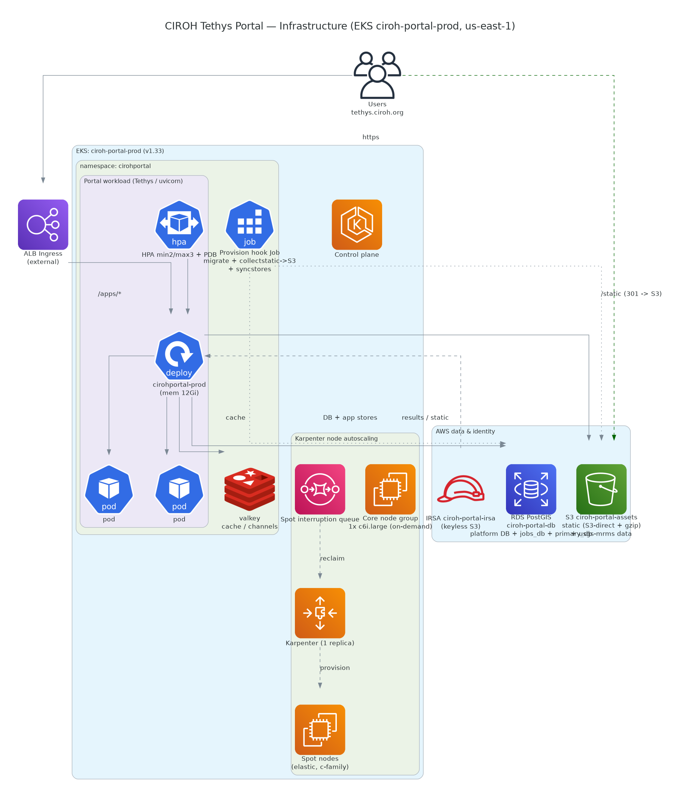
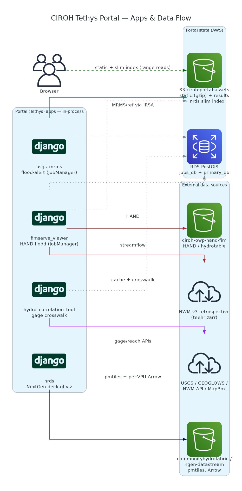

# CIROH Tethys Portal — Architecture

Diagrams of the production portal (`tethys.ciroh.org`), generated with
[`diagrams`](https://diagrams.mingrammer.com/).

## Diagrams

### Infrastructure


Runs on **EKS `ciroh-portal-prod`** (us-east-1, v1.33) in namespace `cirohportal`:

- **Ingress:** an external **ALB** routes `tethys.ciroh.org/apps/*` to the portal;
  `/static` **301-redirects straight to S3** (no CloudFront — bundles are gzipped
  at upload instead).
- **Workload:** `cirohportal-prod` Deployment (Tethys under uvicorn, 12Gi memory)
  behind an **HPA (min 2 / max 3)** and a **PDB**; **valkey** for cache/channels;
  a pre-upgrade **provision hook Job** (migrate + `collectstatic`→S3 + `syncstores`).
- **Nodes (Karpenter):** a 1× on-demand **core node group** hosts the controllers;
  Karpenter provisions **Spot** elastic nodes, draining gracefully off the Spot
  interruption SQS queue.
- **AWS state:** **RDS PostGIS** (`ciroh-portal-db` — platform DB + the app
  persistent stores `jobs_db`/`primary_db`), **S3 `ciroh-portal-assets`** (static +
  usgs-mrms data), and **IRSA** for keyless S3 access.

### Apps & data flow


Apps are installed in-process in the portal image. Each reads its own sources:

- **fimserve_viewer** — HAND flood inundation (in-process JobManager); reads HAND
  from `ciroh-owp-hand-fim` and streamflow from the NWM v3 retrospective (teehr).
- **usgs_mrms** — flood-alert (JobManager); reads MRMS/reference data from
  `ciroh-portal-assets` via IRSA.
- **hydro_correlation_tool** — USGS↔NWM↔GEOGLOWS gage crosswalk; calls
  USGS/GEOGLOWS/NWM/MapBox APIs, caches + stores in `primary_db`.
- **nrds** — NextGen deck.gl viz; pulls PMTiles + per-VPU Arrow from
  `communityhydrofabric`/`ngen-datastream`, and the slim search index (+ JS bundle)
  from portal static. Large data uses HTTP range reads, so those objects are left
  uncompressed.

## Regenerate

```bash
pip install diagrams        # also needs the graphviz `dot` binary on PATH
python docs/architecture/architecture.py
```
